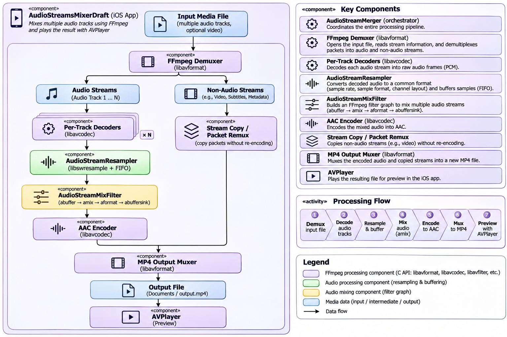

# AudioStreamsMixerDraft

**An experimental iOS application demonstrating multi-track audio mixing, resampling, filtering, and AAC transcoding with FFmpeg's native C APIs.**

AudioStreamsMixerDraft (whose Xcode target is named `MediaFileAudioTracksMerger`) explores how to combine multiple audio tracks in a media file into **one mixed AAC audio track**, while copying non-audio streams into an MP4 output. It is an educational source-code example, not a production-ready mixing SDK or real-time streaming engine.

## Why this project?

FFmpeg's command-line interface makes media transformations look simple:

```bash
ffmpeg -i multitrack.mp4 -filter_complex '[0:a:0][0:a:1]amix=inputs=2' -c:v copy -c:a aac output.mp4
```

Doing similar work through `libavformat`, `libavcodec`, `libswresample`, and `libavfilter` involves stream discovery, per-stream decoders, sample conversion, buffering, filter-graph setup, encoding, timestamp management, and output muxing. This repository is a practical example of how those pieces connect.

## Processing architecture



The diagram describes the source-code processing flow, not an independent background service.

## Actual classes and responsibilities

| Class / protocol | Source | Responsibility |
| --- | --- | --- |
| `AudioStreamMerger` | `AudioStreamMerger.h/.m` | Owns the processing workflow, configures FFmpeg input/output, coordinates decoders, resamplers, mixer, encoder, muxer, cancellation and delegate callbacks. |
| `AudioStreamMergerDelegate` | `AudioStreamMerger.h` | Reports start, progress, errors and completed output path. |
| `AudioStreamResampler` | `AudioStreamResampler.h/.m` | Uses `SwrContext` to convert input audio and an `AVAudioFifo` to buffer converted samples for subsequent processing. |
| `AudioStreamResamplers` | `AudioStreamResampler.h/.m` | Maintains a dictionary of resamplers indexed by input stream. |
| `AudioStreamMixFilter` | `AudioStreamMixFilter.h/.m` | Constructs and runs the FFmpeg audio filter graph with one `abuffer` per input, `amix`, `aformat` and `abuffersink`. |
| `AVCodecParametersWrap` | `AudioStreamMixFilter.h/.m` | Objective-C wrapper for an FFmpeg `AVCodecParameters` pointer. |
| `StreamContext`, `StreamContextContainer` | Internal to `AudioStreamMerger.m` | Hold per-stream codec parameters and decoder contexts, plus the shared output audio encoder context. |
| `ViewController` | `ViewController.h/.m` | Selects bundled samples, starts/stops processing, receives delegate updates and previews the result using `AVPlayer` / `AVPlayerLayer`. |

There is also an `AudioStreamMerger.swift` file containing early scaffold classes (`StreamContext`, `StreamContextContainerSwift`, `AudioStreamMergerSwift`); the implemented processing pipeline is in **Objective-C**, not that Swift scaffold.

## How processing works

### 1. Discover streams and prepare output

`AudioStreamMerger` opens the source using `avformat_open_input` and reads stream metadata with `avformat_find_stream_info`. It creates an MP4 output context and maps the input streams to output streams. Audio inputs get decoder contexts; non-audio streams are configured for packet copying rather than decoding and re-encoding.

### 2. Decode and resample each audio track

Audio packets are decoded to `AVFrame` samples. Each input audio track has its own `AudioStreamResampler`, which uses `libswresample` to convert samples to a suitable representation and an audio FIFO to buffer them. This matters when source tracks have different sample rates, channel layouts, or frame sizes.

### 3. Mix audio with an FFmpeg filter graph

`AudioStreamMixFilter` creates a source filter for each audio stream and connects them to FFmpeg's **`amix`** filter. The output passes through `aformat` to a buffer sink. The class exposes `filterFrame:forStreamIndex:` and `getFilteredFrameForStreamIndex:errorCode:` for pushing decoded/resampled frames and retrieving mixed frames.

### 4. Encode the mixed track as AAC

The merger configures an AAC encoder and sends mixed frames through the encoding pipeline. The code defines AAC-related defaults in `common.h` (including 128 kb/s, 44.1 kHz, stereo and planar float), while `addAudioOutStreamWith:` also derives output settings from the input streams and encoder capabilities. **Do not assume every output is fixed at 44.1 kHz stereo.**

### 5. Mux the MP4 and preview it

Encoded audio packets and copied non-audio packets are written to the output container. On successful completion, the delegate receives the output file path; the sample UI loads the result into an `AVPlayerItem` and plays it using `AVPlayerLayer`.

The output is created in the application's **Documents** directory. An existing output at the generated path is removed before processing.

## Included demo inputs

The sample app's **Media Samples** menu offers:

- `opus.ogg` — a single-track Opus/Ogg sample (`monotrack_opus_1_track.ogg`).
- `multitrack_2_tracks_variable_sample_rates.mkv` — two audio tracks with differing sample rates (bundled resource stem: `multitrack_2_tracks`).
- `multitrack_3tracks.mp4` — three-track MP4 sample (bundled resource stem: `multitrack_3_tracks`).

The visible menu labels and resource filenames differ slightly in the code; check the app bundle if you add or replace samples.

These examples help explore both **transcoding a single audio track** and **mixing multiple tracks**.

## Build and run

1. Clone the repository:

   ```bash
   git clone https://github.com/MaximKomlev/AudioStreamsMixerDraft.git
   cd AudioStreamsMixerDraft
   ```

2. Build the FFmpeg dependency using the project's provided script:

   ```bash
   ./thirdparty/ffmpeg/general/build-ffmpeg.sh
   ```

   The original project recommends **FFmpeg 4.2.2**. Check the script and local build requirements before running it.

3. Open `MediaFileAudioTracksMerger.xcodeproj` in Xcode and configure a compatible iOS build target and signing as needed.
4. Build and run the app.
5. Open **Media Samples**, select a source, and observe processing progress and playback of the resulting MP4.

**Compatibility:** This is older sample code. It uses FFmpeg APIs and build assumptions from the FFmpeg 4.x era, including `avcodec_register_all()`. Current FFmpeg releases and modern Xcode/iOS SDKs may require changes. A successful modern build has not been verified here.

## Public Objective-C API

```objc
#import "AudioStreamMerger.h"

@interface MyController () <AudioStreamMergerDelegate>
@property (nonatomic, strong) AudioStreamMerger *merger;
@end

// Create a merger using a media URL.
self.merger = [[AudioStreamMerger alloc] initWithUrl:sourceURL];
self.merger.delegate = self;
[self.merger start];

// To request cancellation:
// [self.merger stop];
```

The delegate declares:

```objc
- (void)didStart:(AudioStreamMerger *)source;
- (void)didProcessing:(AudioStreamMerger *)source withProgress:(long)progress;
- (void)didError:(AudioStreamMerger *)source error:(NSError *)error;
- (void)didStop:(AudioStreamMerger *)source forFilePath:(NSString *)path;
```

The class also exposes initializers accepting an options dictionary and a dispatch queue. Consult `AudioStreamMerger.h` for exact signatures. The `withProgress:` argument is a `long`; do not assume it represents a normalized percentage without examining the calculation.

## FFmpeg APIs worth studying

| Library | Role in this project |
| --- | --- |
| `libavformat` | Open media, discover streams, create output, interleave/write packets. |
| `libavcodec` | Configure audio decoders and the AAC encoder; decode and encode frames. |
| `libswresample` | Convert decoded audio sample formats, rates and channel layouts. |
| `libavutil` | Audio FIFO, channel layouts, sample formats, timestamps and buffers. |
| `libavfilter` | Construct the multi-input `amix` graph and retrieve mixed audio frames. |

A useful reading order is `ViewController.m` → `AudioStreamMerger.m` → `AudioStreamResampler.m` → `AudioStreamMixFilter.m`.

## Scope and limitations

This repository is an **educational draft**:

- It processes **media files**, not an implemented low-latency live-mixing service.
- It targets a **single mixed AAC output audio track** in an MP4 container.
- Non-audio streams are handled through a copy/remux path; compatibility with the MP4 container still depends on the source codecs.
- FFmpeg 4.x APIs and build tooling may not work unchanged with current toolchains.
- Input formats, timestamp edge cases, differing durations, cancellation and error handling need additional validation for production use.
- The Swift file is a scaffold rather than a parallel Swift implementation.
- The included test target contains the standard example test methods; it is not a comprehensive audio-correctness test suite.

## Ideas for future work

- Modernize the FFmpeg integration and replace removed/deprecated APIs.
- Add deterministic test fixtures for mismatched sample rates, layouts, offsets and durations.
- Validate output timestamps, channel layout and audio quality automatically.
- Expose explicit output codec/bitrate/sample-rate configuration.
- Add volume controls and mixing policies for each source track.
- Improve progress reporting and cancellation tests.
- Add a clearer separation between file I/O, stream processing and presentation UI.

## References

- [FFmpeg documentation](https://ffmpeg.org/documentation.html)
- [FFmpeg audio filters (`amix`)](https://ffmpeg.org/ffmpeg-filters.html#amix)
- [FFmpeg libavfilter API](https://ffmpeg.org/doxygen/trunk/group__lavfi.html)
- [FFmpeg libswresample API](https://ffmpeg.org/doxygen/trunk/group__lswr.html)

## License

See the repository's [`LICENSE`](LICENSE) file for the applicable terms.

---

Created by [Maxim Komlev](https://github.com/MaximKomlev). Contributions and technical discussions are welcome.
